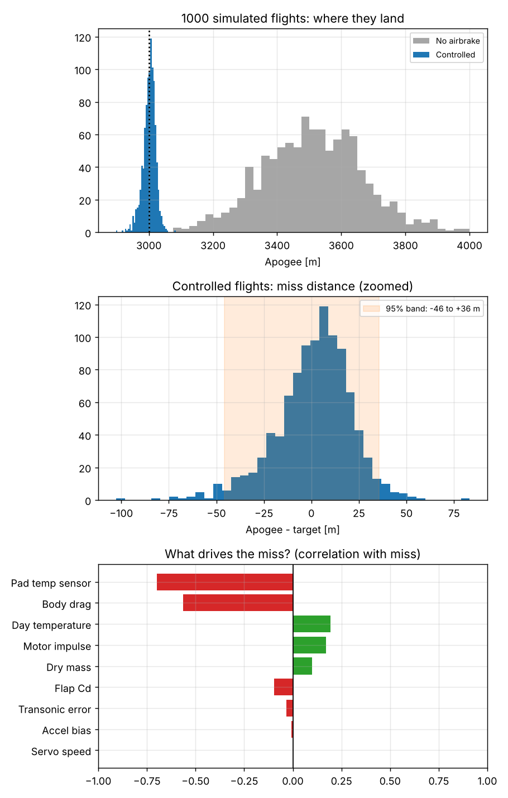
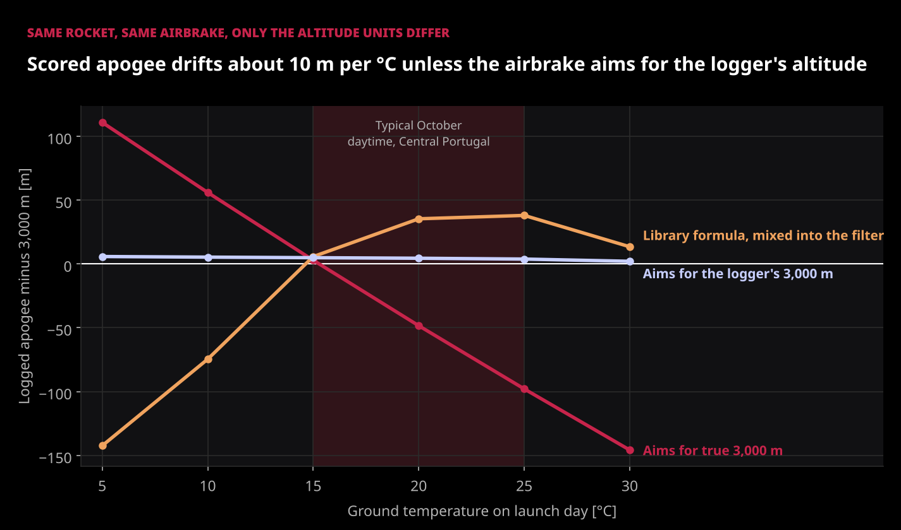

# Airbrake Apogee Control

**Live site:** https://estiuk726.github.io/airbrake-apogee-control/ · **Demo:** [/demo](https://estiuk726.github.io/airbrake-apogee-control/demo/) · **Technical note:** [docs/technical-note.md](docs/technical-note.md)


Simulation, state estimation and Monte Carlo validation of an airbrake controller for a competition rocket targeting a 3,000 m apogee.

**Result:** across 1,000 randomised flights, 95% landed within **-46 m to +36 m** of target (1-sigma 20 m), against a 1-sigma spread of 157 m without the airbrake.



## What it does

The full guidance chain of a flight computer, built step by step:

```
true flight -> barometer + accelerometer -> Kalman filter -> apogee predictor -> controller -> flap servo -> true flight
```

| Step | File | What it adds | Key result |
| --- | --- | --- | --- |
| 1 | `sim_v1.py` | 1-D flight sim: RK4, ISA atmosphere, Mach-dependent drag, mass loss | Uncontrolled apogee 3,503 m |
| 2 | `sim_v2.py` | Airbrake drag model, authority and timing study | Full flaps remove ~970 m; braking late is almost useless |
| 3a | `sensors.py` | Barometer noise and transonic error, accelerometer noise and bias | Baro-derived velocity error +/-149 m/s; accel drift 52 m |
| 3b | `kalman.py` | 3-state Kalman filter [altitude, velocity, accel bias], gating vs Mach lockout | Max altitude error 142 m -> 3 m with Mach lockout |
| 4a | `predictors.py` | Energy, analytic-drag and forward-simulation apogee predictors | Forward sim within 6 m at burnout |
| 4b | `control.py` | Closed-loop proportional controller with servo rate limit | 3,003 m against a 3,000 m target |
| 5 | `monte_carlo.py` | 1,000 flights with 9 random uncertainties, sensitivity analysis | 95% band -46/+36 m; pad temperature is the top error source |
| 6 | `adaptive.py` | In-flight learning of body and flap drag scales (Bayesian least squares) | 1-sigma 19.9 -> 18.5 m; drag error removed as a cause |
| 7 | `wind2d.py` | 2-D flight with wind and a 5 deg rail; gyro-based tilt-aware filter and predictor | Reachable flights: 1-sigma 61 m (1-D computer) -> 22 m (tilt-aware) |
| 8 | `eclipse.py`, `official_logger.py` | Eclipse-like model from public numbers; EuRoC's CATS Vega logger formula (fixed 15 °C); airbrake aiming for true vs logger altitude | Logged miss 1-sigma 55 m -> 15 m; mean -62 m -> -2 m |

## Run it

```bash
pip install -r requirements.txt
python sim_v1.py        # each step script writes its figure to figures/
python monte_carlo.py   # about 2-3 minutes on 2 cores
```

## Interactive demo

`demo/index.html` is a self-contained JavaScript port of the same simulator. Open it in a browser to:

- enter your own rocket (diameter, Cd, masses, motor impulse and burn time, flap area, servo speed, controller gain) or pick a 3 km or 9 km preset
- add wind and a launch rail angle, and switch between the 1-D and tilt-aware flight computer, with or without in-flight drag learning
- load real rocket data: a RASP `.eng` motor thrust curve and a drag coefficient vs Mach CSV exported from OpenRocket or RocketPy (sample files built in)
- watch an animated replay of the flight with flaps opening, wind arrows and live readouts
- run a **launch day check**: enter today's wind, temperature, pressure and rail tilt to get predicted apogee, a GO / CAUTION / NO-GO verdict, the expected landing band and today's wind limit
- change the real-world conditions the flight computer does not know about
- fly 100 to 1,000 Monte Carlo rockets with adjustable uncertainty spreads, and view the miss histogram, apogees with and without the airbrake, a sensitivity ranking, miss vs drag error, or miss vs wind

## Step 8: score what the judges measure

EuRoC scores apogee from the mandatory CATS Vega logger. Its firmware converts pressure to altitude with a **fixed 15 °C ground temperature** (`calculate_height()` in catsystems/cats-embedded). On a warm day it under-reads: a true 3,000 m is logged as about 2,897 m at 25 °C.

An airbrake that aims for true altitude therefore misses the scored apogee by about 10 m per °C. Aiming for the **pressure at which CATS reads 3,000 m** removes the bias:

| Airbrake aims for | Mean logged miss | 1-sigma | Within ±25 m |
| --- | --- | --- | --- |
| True 3,000 m | -61.6 m | 55.1 m | 21.6% |
| Library formula mixed into the filter | +30.5 m | 31.3 m | 44.6% |
| Logger's 3,000 m (pressure target) | -2.3 m | 15.3 m | 91.4% |

139 reachable flights of 240 random launch days (weather, wind, motor and build errors). The library formula itself matches CATS within 0.2 m; its error comes from fusing "15 °C metres" with an accelerometer in true metres.



This is an independent study from public sources; the Eclipse-like rocket uses three public numbers plus stated assumptions (see `eclipse.py`).

## Main findings

- **Braking must happen early.** Drag scales with velocity squared, so a 3 s full-open pulse removes 577 m at burnout but only 35 m twelve seconds later.
- **Do not trust the barometer near Mach 1.** A plain Kalman filter blamed the transonic pressure dip on the accelerometer and was 87 m/s wrong in velocity at the moment braking matters most. A Mach-based lockout fixed it.
- **Predict, do not just react.** An energy-only apogee estimate is 1,947 m wrong at burnout; an onboard forward simulation is 6 m wrong.
- **A 1-D flight computer fails in wind.** Tilted flight means airspeed is higher than vertical speed, so the transonic barometer lockout must use airspeed (vertical speed from the filter plus pitch from the gyro). That one change took windy flights from 1-sigma 48 m to 22 m.
- **Aim for the logger's altitude (step 8).** The scored apogee comes from a logger that assumes 15 °C, so the target should be a pressure, not a true height. This supersedes the earlier pad-temperature finding for scoring purposes.
- **The pad temperature sensor matters most (for true altitude).** It sets the pressure-to-altitude conversion; 1 K of error is about 10 m at 3 km, the largest single contributor to the miss.

## Limitations

- The 2-D model (step 7) assumes the rocket instantly aligns with the relative wind (zero angle of attack), a worst case for weathercocking. No gusts or 3-D effects.
- Rocket, motor and flap values are placeholders, not a real vehicle.
- The transonic barometer error and the Cd-Mach curve are illustrative.

## Next steps

1. In-flight drag estimation (adaptive control) to remove the drag-mismatch error.
3. Real vehicle data from OpenRocket or CFD.
4. Port the estimator and controller to C on a microcontroller and run hardware-in-the-loop against this simulator.

## Author

A. E. M. Estiuk Ahmed, BSc Professional Pilot, Budapest University of Technology and Economics.
