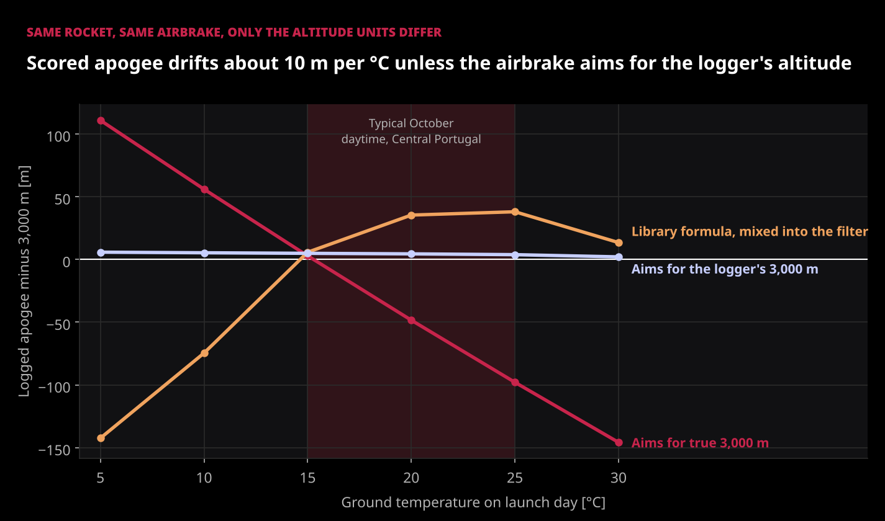
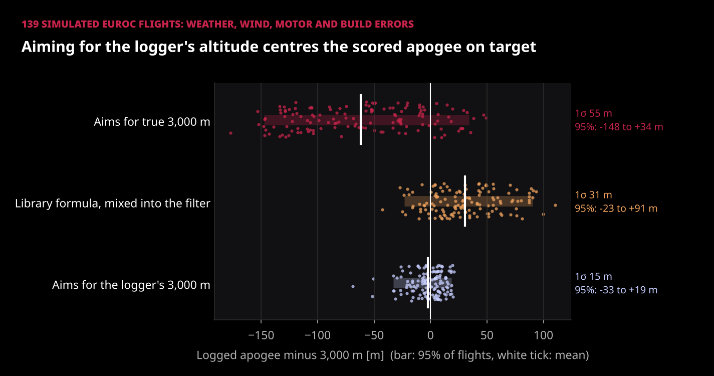

# Scoring the Apogee the Judges Measure: CATS Vega Altitude and the Eclipse Airbrake

20 November 2026 · A. E. M. Estiuk Ahmed

The EuRoC apogee that gets scored is not the rocket's true height: the mandatory CATS Vega logger converts pressure to altitude as if the ground were at 15 °C. On a 25 °C launch day a true 3,000 m is logged as about 2,897 m.

*Independent analysis prepared for BME Suborbitals. Based only on public sources and the open-source CATS firmware; not reviewed by the team.*

## Summary

- **The bias is about 10 m per °C** away from 15 °C. October afternoons in Central Portugal average around 21 °C, which puts a true 3,000 m roughly 60 m below target on the official log.
- **It depends on what the airbrake computer aims for.** In simulation of an Eclipse-like rocket over 139 launch days that could reach the target, aiming for true altitude gave a mean logged miss of −62 m (1σ 55 m). Aiming for the logger's own altitude gave −2 m (1σ 15 m), with 91% of flights within ±25 m.
- **The fix is software only:** compute the target as the pressure at which CATS reads 3,000 m, and stop the climb there. No hardware change, no extra sensor.
- **Hot days also cost margin:** a logged 3,000 m at 30 °C needs about 3,158 m of true height, so the motor must overshoot more than a standard-day simulation suggests.

## 1. The official logger assumes a 15 °C day

EuRoC determines the competition apogee from a mandatory CATS Vega flight computer, and modifications to it are not allowed. Its firmware (catsystems/cats-embedded, commit f366de8) converts pressure to height with fixed constants:

```cpp
// flight_computer/src/config/control_config.hpp
inline constexpr float P_INITIAL = 101250.0F;
inline constexpr float TEMPERATURE_0 = 15.0F;   // °C

// flight_computer/src/control/data_processing.cpp
float32_t calculate_height(float32_t pressure) {
  return (-(powf(pressure / P_INITIAL, (1 / 5.257F)) - 1) * (TEMPERATURE_0 + 273.15F) / 0.0065F);
}
```

The logged altitude is this height minus the same height averaged over about 5 s on the pad and frozen at liftoff (task_preprocessing.cpp). The recorded apogee is the maximum of CATS's own Kalman-filtered height (recorder.cpp), which near apogee follows the barometer closely: expect 1 to 3 m of extra bias, not tens of metres.

When the real air is warmer than 15 °C, pressure falls more slowly with height, so the logger under-reads. To first order the logged height is the true height times 288.15 / T₀, with T₀ the ground temperature in kelvin.

| Ground temperature | True 3,000 m is logged as | True height needed for a logged 3,000 m |
| --- | --- | --- |
| 10 °C | 3,051 m | 2,950 m |
| 15 °C | 2,998 m | 3,002 m |
| 20 °C | 2,947 m | 3,054 m |
| 25 °C | 2,897 m | 3,106 m |
| 30 °C | 2,850 m | 3,158 m |

Standard lapse rate of 6.5 K/km and pad pressure 1010 hPa. A different lapse rate shifts these by a few metres: what matters is the average temperature of the air between the pad and apogee. Pad pressure matters too: at 15 °C, a pad at 950 hPa logs a true 3,000 m as about 2,963 m.

## 2. Method

The test rocket is an Eclipse-like model whose motor was tuned so it reproduces Eclipse's published rail exit and maximum speeds within 1%. It flies a full guidance chain: barometer and accelerometer with realistic errors, a Kalman filter with transonic barometer lockout, gyro-based airspeed, in-flight learning of body and flap drag, a 2-D apogee predictor and a rate-limited flap controller active from 900 m.

| Parameter | Value | Source |
| --- | --- | --- |
| Liftoff mass | 33 kg | Public |
| Rail exit / maximum speed | 164 / 970 km/h (model: 163 / 968) | Public |
| Airbrake active | from 900 m | Public |
| Rail | 12 m at 84° elevation | EuRoC SRD |
| Motor | 9,826 Ns over 4.13 s, 5.4 kg propellant | Calibrated to the speeds |
| Diameter, subsonic Cd | 140 mm, 0.45 | Assumption |
| Flap area, flap Cd, servo | 100 cm², 1.2, 0.5 s full travel | Assumption |

Three versions of the flight computer were flown, identical except for how they turn pressure into altitude:

1. **True altitude:** converts pressure using its measured pad temperature and aims for 3,000 m of true height. This is also what a GPS-based or temperature-corrected computer does.
2. **Library formula, mixed into the filter:** the common 44,330 × (1 − (p/1013.25 hPa)^0.1903) pressure altitude, relative to the pad, fed straight into the same filter and predictor, aiming for 3,000. On its own this formula agrees with CATS to within 0.2 m; this version tests what happens when its heights meet an accelerometer and a predictor that work in true metres.
3. **Logger altitude:** keeps the physics in true metres, but its target is the pressure at which CATS reads 3,000 m.

The Monte Carlo drew 240 launch days at random:

- **Weather:** ground temperature 12 to 30 °C, lapse rate 5 to 8 K/km, pad pressure 995 to 1020 hPa, wind ±6 m/s.
- **Rocket:** body drag ±7%, motor impulse ±3%, mass ±1.5%, flap drag ±10% (1σ).
- **Sensors and actuator:** accelerometer bias, pad temperature sensor ±1 K, transonic barometer error, servo speed.

Each day was flown with all three computers. The logged apogee is the CATS formula applied to the pressure at the true apogee.

## 3. Results

Aiming for the logger's altitude keeps the scored apogee within 6 m of target from 5 to 30 °C; aiming for true altitude drifts by about 10 m per °C.

With the nominal rocket on a calm day, the true-altitude computer was logged at +111 m on a 5 °C day and −146 m on a 30 °C day. The library-formula version did well near 15 °C but drifted to −143 m and +38 m at the extremes. The formula is not the problem: its barometer heights are in "15 °C metres" while the accelerometer, drag learning and predictor work in true metres, so the filter mixes two scales and mis-estimates bias and speed. Converting only the target, as the logger version does, avoids this.



Across the random launch days, 139 of 240 could reach a logged 3,000 m with the flaps closed. Statistics are for those flights:

| Flight computer aims for | Mean logged miss | 1σ | 95% of flights | Within ±25 m | Drift per °C |
| --- | --- | --- | --- | --- | --- |
| True 3,000 m | −61.6 m | 55.1 m | −148 to +34 m | 21.6% | −10.2 m |
| Library formula, mixed into the filter | +30.5 m | 31.3 m | −23 to +91 m | 44.6% | +5.1 m |
| Logger's 3,000 m | −2.3 m | 15.3 m | −33 to +19 m | 91.4% | −0.3 m |



The 101 flights that could not reach the target fell short mainly through lower motor impulse and higher drag, then wind blowing back over the pad and warmer days (73% could reach the target below 18 °C, 52% above 24 °C). The model's assumed overshoot margin is only about 125 m on a standard day. Treat that count as a warning about margin, not as a prediction for Eclipse: it depends heavily on the assumed diameter and drag.

## 4. Recommendation: aim for a pressure, not a height

Set the airbrake target as the pressure at which CATS will read 3,000 m, computed on the pad from the same formula. The logger only ever sees pressure, so reaching that pressure at apogee scores 3,000 m whatever the weather.

1. **On the pad,** average the barometer over the same window CATS uses before liftoff (about 5 s), giving p_pad.
2. **Compute the target pressure** with the CATS constants: h₀ = H(p_pad), then p_target = 101,250 × (1 − (3000 + h₀) × 0.0065 / 288.15)^5.257, where H is the formula in section 1.
3. **Keep the guidance physics in true metres.** Convert pressure to true height with your best atmosphere model, run the filter and the apogee predictor as now, and convert p_target into a true-height target with the same model. Temperature errors cancel at apogee, because the same model converts both the measurement and the target.
4. **Do not mix unit systems** inside the filter: a barometer in "15 °C metres" fused with an accelerometer in true metres caused the library formula's drift above.
5. **Size the motor for the hottest expected day:** a logged 3,000 m at 30 °C needs about 3,160 m of true height before the airbrake has anything to remove.

```python
def cats_height(p):           # identical to CATS Vega calculate_height()
    return -((p / 101250.0) ** (1 / 5.257) - 1) * 288.15 / 0.0065

def target_pressure(p_pad, target_m=3000.0):
    h = target_m + cats_height(p_pad)
    return 101250.0 * (1 - h * 0.0065 / 288.15) ** 5.257
```

**Bench test before the next campaign:** put the team's flight computer and a CATS Vega in the same sealed jar, pump it down slowly from ground pressure to about 700 hPa, and log both. The two altitude traces should agree to within sensor noise when the team's computer reports in logger units. A difference that grows with altitude means the formulas differ.

## 5. Limits and questions for the team

The size of the effect is solid: it follows directly from the firmware and basic physics. How much it affected Eclipse is unknown, because that depends on choices inside the team's flight computer that are not public.

**Limits**

- The rocket is a reconstruction from three public numbers; diameter, drag and flap size are assumptions.
- The model is a 2-D point mass with instant weathercocking; no gusts or 6-DOF dynamics.
- The CATS logger's own Kalman filtering and sensor noise are not modelled; the logged apogee is taken as the formula applied to the true apogee pressure.
- Real launch-day atmospheres can have inversions; the lapse range used was 5 to 8 K/km. Aiming for a pressure stays correct with any profile; only the size of the true-altitude error changes.
- The pad temperature error of ±1 K is optimistic for a sensor inside a sun-heated avionics bay, and bay heating then cooling in flight can drift a barometer by about 4 m after the pad reference is frozen.
- The firmware read is commit f366de8 of the public repository; the version flown at EuRoC may differ, so the constants should be confirmed with the organisers.

**Questions that would settle it**

- [ ] How does the airbrake computer convert pressure to altitude: fixed 15 °C, measured temperature, GPS, or a fused estimate?
- [ ] What was the ground temperature at Eclipse's launch time, and what apogee did the team's own computer record next to the official 3,065 m?
- [ ] Could the Eclipse logs (team computer and CATS) be shared? Comparing the two altitude traces would measure this offset directly.

## Sources

- [CATS Vega firmware, catsystems/cats-embedded](https://github.com/catsystems/cats-embedded) (commit f366de8, files cited in section 1)
- [EuRoC System Requirements Document 2025](https://euroc.pt/wp-content/uploads/2025/03/PTS_EDU_EuRoC_ST_001928_SRD_v01-1.pdf): mandatory CATS Vega, 12 m rail at 84°, airbrake requirements
- [EuRoC Competition Rules 2026](https://euroc.pt/wp-content/uploads/2026/05/PTS_EDU_EuRoC_ST_001905_CR_v1.1.pdf): Flight Performance worth 350 of 1,000 points
- [Eclipse mission parameters, Műszaki Magazin](https://www.muszaki-magazin.hu/2026/09/29/suborbitals-bme-raketa-fejlesztes-2): liftoff mass, rail exit and maximum speed, airbrake window
- [EuRoC 2026 result, hirnavigator.hu](https://hirnavigator.hu/hir/10979984-remekul-szerepelt-a-bme-suborbitals-az-euroc-versenyen): Eclipse apogee 3,065 m
- [Independent CATS Vega flight analysis](https://tonuonu.github.io/MyLevel1Peregrine/flight/flight1-analysis): notes the hardcoded 15 °C
- [Central Portugal October climate, Sunheron](https://sunheron.com/europe/portugal/central-portugal-weather-october/): 21 °C average daytime
- Analysis code and data: [`eclipse.py`](../eclipse.py), [`official_logger.py`](../official_logger.py), [`results/official_logger.json`](../results/official_logger.json)
